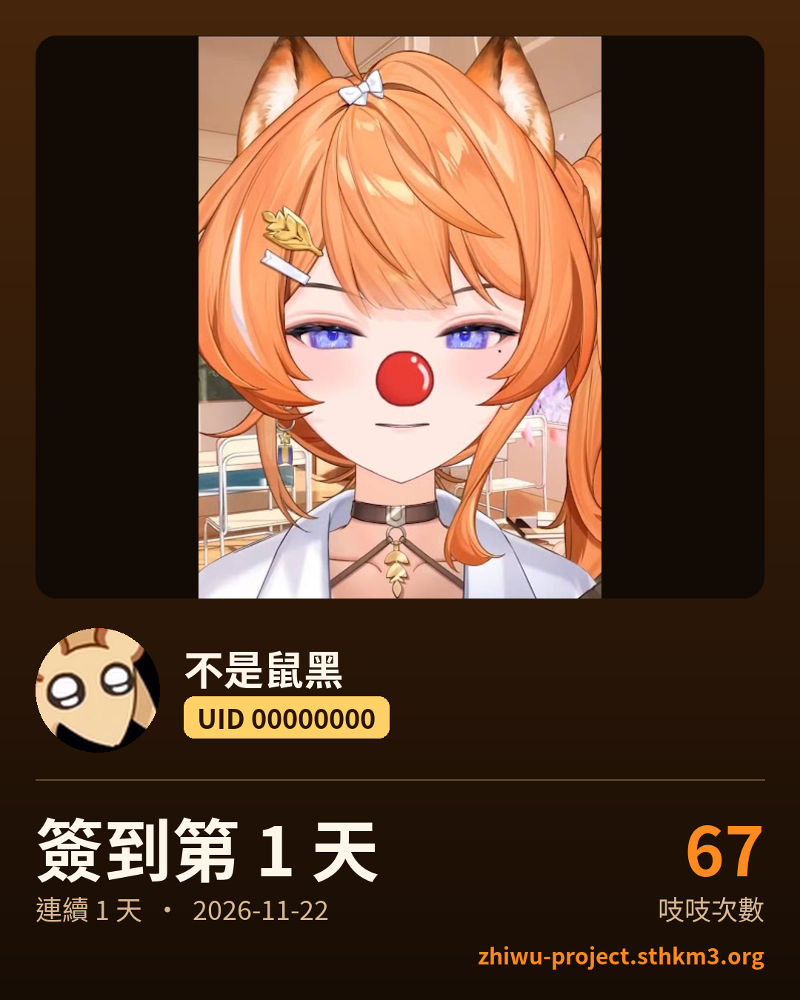

# 吱鼯計畫

> 你今天吱吱了嗎

每天來吱一下，領一張吱咪小卡的簽到網站。

**https://zhiwu-project.sthkm3.org**



## 怎麼玩

1. 用信箱登入：輸入信箱收 6 位數驗證碼，第一次登入會自動建立帳號，不用設密碼
2. 登入後整個畫面是一扇門，中間寫著「點擊吱吱」，點下去（記得開聲音）
3. 吱完就簽到成功，拿到今天的小卡，可以分享或下載

每天台灣時間 04:00 換日，換日後可以再簽到一次。

不想登入也可以按「訪客吱吱」直接吱。

## 功能

- **吱咪小卡**：每次簽到從圖庫隨機抽一張圖，加上你的名稱、大頭貼、簽到天數和吱吱次數。分享連結貼到 Discord、X、LINE 會出現小卡預覽
- **繼續吱吱**：簽到完還想吱，可以回去一直吱。每吱完一次才能吱下一次，一秒最多算一次
- **全自動吱吱**：懶得點的話，繼續吱吱畫面下方有開關，打開就會自己一直吱
- **訪客吱吱**：不用登入就能吱，會拿到一張「訪客 #四位亂碼」的小卡。代號和次數只記在你自己的瀏覽器，伺服器不會記；之後登入的話帳號從頭算，訪客的次數不會帶過去
- **兩個數字分開算**：簽到天數一天只加一次；吱吱次數每吱一下加一次
- **投稿圖片**：可以上傳你覺得適合放上小卡的圖，每天最多 5 張，管理員審核通過後加入圖庫
- **個人頁**：名稱、大頭貼、自我介紹（支援 Markdown）
- **稱號**：管理員可以幫指定的 UID 加上顏色和稱號
- **加到主畫面**：手機上可以安裝到桌面，像 App 一樣打開
- **語言**：繁體中文、简体中文、日本語、한국어、English

## 關於這個網站

這是粉絲做的玩笑網站，梗來自子午計畫（Meridian Project）的橙 Yuzumi。本站和子午計畫官方沒有任何關係，站上的影片與圖片版權屬於原作者。

- 信箱只用來寄登入驗證碼
- 訪客吱吱不會在伺服器留下任何紀錄
- 上傳的圖片會重新編碼並移除 EXIF（包含 GPS）資訊

## 更新紀錄

- **1.0.1**：新增訪客吱吱；每個 UID 都有底色；每頁最下方加上 Yuzumi 官方頁面連結；手機可以加到主畫面
- **1.0.0**：第一版。吱吱簽到、吱咪小卡、繼續吱吱、全自動吱吱、投稿圖片、稱號

## 自己架一個

需要 Docker。

```
cp .env.example .env
docker network create tunnel
docker compose up -d --build
```

打開 `http://127.0.0.1:2041`。`.env` 裡的寄信帳密留空時不會寄信，驗證碼會印在 `docker compose logs zhiwuproject`。

圖庫放在 `image/`（jpg / png / webp / gif），新增圖片不用重啟。

也可以不 build，直接拉現成的映像：`docker pull gitea.sthkm3.org/sthkm3/zhiwuproject:1.0.1`

## 技術

FastAPI + SQLite，小卡用 Pillow 在伺服器端畫成 PNG；前端是不用框架的 HTML / CSS / JavaScript。整包跑在一個 Docker 容器裡，透過 Cloudflare Tunnel 對外。
